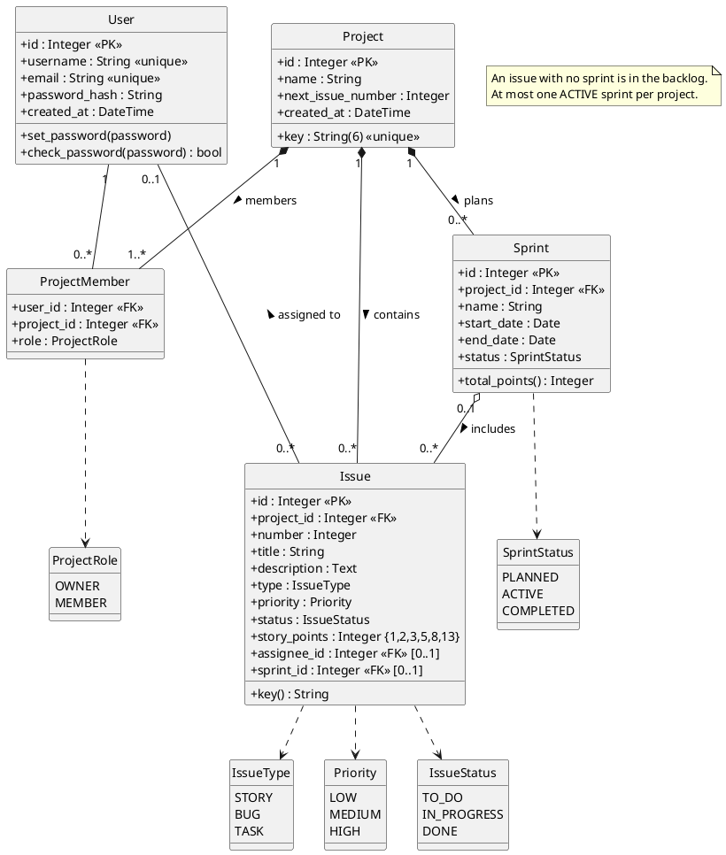
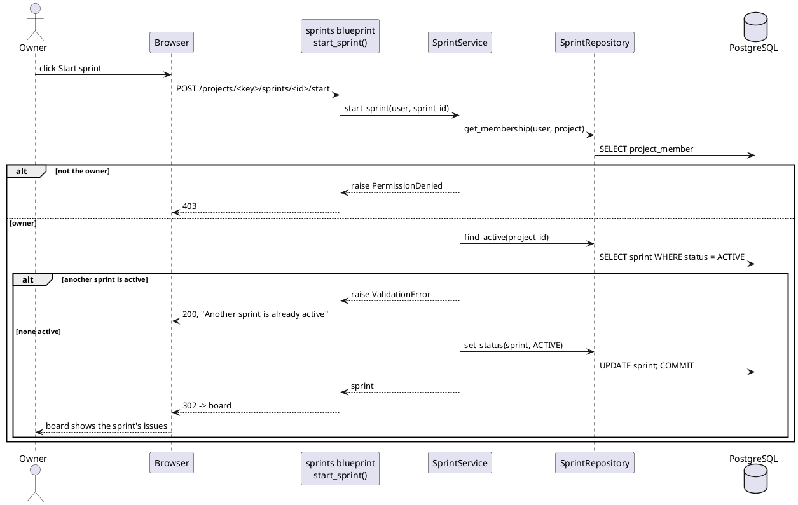

# /uml

Three diagrams, each **+5** in the Documentation rubric: use case, sequence, class. All three must be **in the README**, not only in `uml/`. Take which one from the request; with none, do all three.

## Sources

- **Use case diagram**: the user stories in [README.md](../../../README.md#user-stories). Every use case maps to a story; every story appears.
- **Class diagram**: `src/app/models.py` once it exists - read the code, a diagram drawn from memory drifts. Before the code exists, the acceptance criteria and decisions from `/new-design`.
- **Sequence diagram**: the story's route, service and repository code, and its criteria.

## Use case diagram

`uml/use-case.wsd` already exists. Actors: Visitor, Member, Project owner (a specialisation of Member). US1-US11 all appear. Keep the `(US#)` in each use case name so the grader can trace it, and update it if a story is added or dropped.

## Class diagram

`uml/class.wsd` - **model classes only**. The assignment says no framework, library, controller, route, repository, service, test or utility classes. Show attributes, key methods, and associations **with multiplicities**. The template ships a stub `User` - replace it.



Add `Comment` (`id`, `issue_id`, `author_id`, `body`, `created_at`; `Issue "1" *-- "0..*" Comment`, `User "1" -- "0..*" Comment : writes >`) - the foundation creates it with the other models. This is a starting shape, not the answer - match it to the actual models.

## Sequence diagram

`uml/sequence-US<n>.wsd` (the template `uml/sequence-US#.wsd` is a placeholder - replace it) shows **one implemented story's flow, not registration or login**, from the browser through **all three layers** - route, service, repository - to PostgreSQL, with **at least one alternative path**. US7 (start a sprint) is the suggested choice because its rule gives a natural `alt`.



Every message is something the code actually does, in the order it does it.

## Render and embed

PlantUML is not installed by default. Either the PlantUML extension in VS Code / IntelliJ (export PNG), or:

```
java -jar plantuml.jar uml/use-case.wsd uml/class.wsd uml/sequence-US7.wsd
```

Commit the PNGs beside the sources and embed each in its README section (``), so the grader does not have to render them.

## Keep them true

A diagram that disagrees with the code is worth less than one that is plainly incomplete. Re-run after any `/new-model`, and when the story's flow changes.
