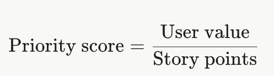

# TaskBoard

CS3250 Project 3 - a small Jira-style project management web app. The assignment and rubric are in [ASSIGNMENT.md](ASSIGNMENT.md); this README follows [README_template.md](README_template.md).

Repository: https://github.com/AdenPotato/CS3250-project-3

## Team

| Person | GitHub | Role |
| --- | --- | --- |
| `<name>` | `<login>` | Scrum Master |
| `<name>` | `<login>` | Developer |
| `<name>` | `<login>` | Developer |

# Overview

## Mission statement

TaskBoard gives small teams - student project groups, clubs, two-to-five person startups - one simple place to plan and track their work. A team creates a project, keeps its stories, bugs and tasks in a backlog, plans them into sprints and follows progress on a board, without the setup and weight of a full enterprise tool.

**Target audience:** small teams of 2-10 people running Scrum or a lightweight agile process.

**Look and feel:** a clean, minimal interface in the style of shadcn/ui (neutral zinc palette, cards, subtle borders), in both light and dark mode.

**Scope:** deliberately small. One kind of project, a fixed set of issue types and statuses, owner and member roles only. No custom workflows, no notifications, no integrations.

## Use case diagram

Source: [uml/use-case.wsd](uml/use-case.wsd)


Actors:

- **Visitor** - not signed in. Can register and log in.
- **Member** - a signed-in user who belongs to a project. Works with issues and the board.
- **Project owner** - a member who created the project. Also manages members and sprints.

# User Stories

US1-US7 are required; US8-US11 are optional (bonus). Each acceptance criterion is numbered so it can be referenced as `US#.n` (for example US5.2) in issues, PRs and tests.

## Designed to be independent

The stories are written so that **no story needs another story to work or to be built**. Each one owns its own pages, its own service and its own tests, and two people can build any two stories at the same time. What every story would otherwise share lives in one **foundation** task, done first in Sprint 1:

- the app factory, configuration and the Docker Compose setup
- **every model** from the class diagram (including Comment), so no story changes the schema
- seed data: several users, a project with an owner and a member, issues in each status, and a planned sprint - so every story has something to work on without another story's create page
- Flask-Login wiring (`login_required`, the user loader) and one shared check that **every project page is for project members only** (others get 403)
- the base layout with the navigation and the light/dark theme stylesheet (it follows the system setting)
- the dashboard listing my projects, with the empty state "You have no projects yet"
- a stub "coming soon" page for every route in the navigation, which each story replaces

Stories touch shared data only through the models (for example the board reads which sprint is active), never through another story's pages or code. The foundation is not a user story and has no story points; the team should leave room for it in Sprint 1's capacity.

### US1 - Register an account

As a new user, I want to create an account so that I can join and manage projects.

Acceptance Criteria

1. Given that I am on the register page, When I submit a unique username, a unique email and a password of at least 8 characters, Then my account is created and I am sent to the login page with a success message.
2. Given that the username or email is already registered, When I submit the form, Then I see "username already taken" or "email already registered" and no account is created.
3. Given that a field is empty or the password is shorter than 8 characters, When I submit the form, Then the invalid field is identified with an error and no account is created.
4. Given that an account was created, When its row is read from the database, Then the password is stored as a hash, never as plain text.

### US2 - Log in and out

As a registered user, I want to log in and out so that only I can access my projects.

Acceptance Criteria

1. Given that I have an account, When I log in with the correct username and password, Then I land on my projects dashboard.
2. Given that I enter a wrong username or password, When I submit the login form, Then I see "invalid username or password" and stay logged out.
3. Given that I am logged out, When I open the dashboard or any project page, Then I am redirected to the login page.
4. Given that I am logged in, When I click Log out, Then my session ends and I return to the login page.

### US3 - Create a project

As a user, I want to create a project with a name and a short key (for example `WEB`) so that I can organize my team's work.

Acceptance Criteria

1. Given that I am logged in, When I create a project with a name and a unique key of 2-6 uppercase letters, Then it appears on my dashboard and I am its owner.
2. Given that the key is already used by another project, When I submit, Then I see "project key already in use" and no project is created.
3. Given that the name is empty or the key is not 2-6 uppercase letters, When I submit, Then the invalid field is identified with an error and no project is created.

### US4 - Manage project members

As a project owner, I want to add and remove project members so that the right people can work on the project.

Acceptance Criteria

1. Given that I own a project, When I add a registered user by username on the Members page, Then they appear in the member list and the project appears on their dashboard.
2. Given that the username does not exist or is already a member, When I add it, Then I see an error saying which and the member list is unchanged.
3. Given that I own a project, When I remove a member, Then they leave the member list and the project is no longer on their dashboard.
4. Given that I am a member but not the owner, When I try to add or remove a member, Then I am denied (403) and the member list is unchanged.

### US5 - Create and edit issues in the backlog

As a project member, I want to create issues with a title, description, type, priority, story points and assignee so that the team's work is tracked in the backlog.

Acceptance Criteria

1. Given that I am a member, When I create an issue with a title, a type (story, bug or task), a priority (low, medium, high) and optional description, story points and assignee, Then it appears on the Backlog page with a key made of the project key and a number (for example `WEB-3`) and the status To Do.
2. Given that the title is empty, or the story points are not one of 1, 2, 3, 5, 8, 13, When I submit, Then I see the error beside the field and no issue is created.
3. Given that an issue exists, When a member edits its title, description, type, priority, story points or assignee, Then the Backlog page shows the new values.
4. Given that an issue exists, When a member deletes it and confirms, Then it no longer exists in the project.
5. Given that I pick an assignee, When I open the assignee list, Then it only offers members of the project.
6. Given that an issue belongs to a sprint, When I open the Backlog page, Then it is not listed - the backlog shows only issues with no sprint.

### US6 - Board view with status changes

As a project member, I want to see issues in To Do, In Progress and Done columns and change their status so that I can see progress at a glance.

Acceptance Criteria

1. Given that the project has issues, When I open the Board, Then each issue appears in the column for its status, showing its key, title, assignee and story points.
2. Given that one of the project's sprints is active, When I open the Board, Then only that sprint's issues are shown, and the sprint's name is the board's heading.
3. Given that an issue is on the board, When I change its status, Then it moves to the new column and stays there after a page refresh.
4. Given that the board has no issues to show, When I open it, Then I see "No issues to show".

### US7 - Plan sprints

As a project owner, I want to create sprints, fill them with issues, and start and complete them so that we can plan our iterations.

Acceptance Criteria

1. Given that I own the project, When I create a sprint on the Sprints page with a name, a start date and an end date after the start date, Then it is listed with the status Planned.
2. Given that a sprint is planned, When I add issues that are in no sprint to it, Then they are listed under that sprint with the sprint's total story points.
3. Given that a sprint is planned and no other sprint is active, When I start it, Then its status becomes Active; starting a second sprint while one is active is refused with "another sprint is already active".
4. Given that a sprint is active, When I complete it, Then its status becomes Completed and its issues that are not Done are removed from it, back into no sprint.
5. Given that I am a member but not the owner, When I try to create, fill, start or complete a sprint, Then I am denied (403).

### US8 - Comment on issues (optional)

As a project member, I want to comment on an issue so that the team can discuss it in one place.

Acceptance Criteria

1. Given that I open an issue's Comments page, When I submit a non-empty comment, Then it appears with my username and the time.
2. Given that an issue has several comments, When I view them, Then they are shown newest first.
3. Given that the comment is empty, When I submit, Then I see an error and nothing is saved.

### US9 - Search issues (optional)

As a project member, I want to search the project's issues by field so that I can find the ones I care about.

Acceptance Criteria

1. Given that I am on the project's Search page, When I filter by assignee, type, priority or status, Then only matching issues are shown, from the backlog and every sprint.
2. Given that I combine filters, When I apply them, Then only issues matching all of them are shown.
3. Given that no issues match, When I apply the filter, Then I see "No issues match these filters".

### US10 - My work page (optional)

As a user, I want one page listing every issue assigned to me so that I know what to work on next.

Acceptance Criteria

1. Given that I am assigned issues in several projects, When I open My Work, Then I see every one of them with its project, key, title, status and priority.
2. Given that an issue is Done, When I open My Work, Then it is not listed.
3. Given that nothing is assigned to me, When I open My Work, Then I see "Nothing assigned to you".

### US11 - Light and dark mode toggle (optional)

As a user, I want to switch between light and dark mode so that the app is comfortable to use in any lighting.

Acceptance Criteria

1. Given that I have never chosen a theme, When I open any page, Then it uses my operating system's light or dark setting.
2. Given that I am on any page, When I click the theme toggle in the navigation, Then the page switches between light and dark immediately, without reloading.
3. Given that I chose a theme, When I open another page or come back later in the same browser, Then my choice is kept.

# Product Backlog

User value: 3 = high, 2 = medium, 1 = low. Story points use the Fibonacci sequence (1, 2, 3, 5, 8, 13) and are estimated by the team.

Priority Score = User value / Story points



| ID | Rank | User value | Story Points | Priority Score | Depends on | Type |
| --- | --- | --- | --- | --- | --- | --- |
| US1 | — | 3 | — | — | — | Required |
| US2 | — | 3 | — | — | — | Required |
| US3 | — | 3 | — | — | — | Required |
| US4 | — | 2 | — | — | — | Required |
| US5 | — | 3 | — | — | — | Required |
| US6 | — | 3 | — | — | — | Required |
| US7 | — | 2 | — | — | — | Required |
| US8 | — | 1 | — | — | — | Optional |
| US9 | — | 1 | — | — | — | Optional |
| US10 | — | 2 | — | — | — | Optional |
| US11 | — | 1 | — | — | — | Optional |

No story depends on another; every story depends only on the Sprint 1 foundation (see [Designed to be independent](#designed-to-be-independent)). US2's login works with the seeded accounts before US1 is built, and every other story works on the seeded project, members, issues and sprint.

# Sprint Planning

Sprint 0 covers planning only: product vision, user stories, estimates, backlog prioritization, UML diagrams, repository setup and the development environment. No implementation is scheduled in Sprint 0. Sprints 1-3 are one week each and end in a tagged release (v1, v2, v3).

```
Team capacity (story points per sprint): <your team's capacity>

Justification (one or two sentences: team size, hours available, course load): <justification>
```

| Sprint | User stories (in order) | Story points planned | Points remaining after sprint | Dependencies checked (Y/N) |
| --- | --- | --- | --- | --- |
| Sprint 1 |  |  |  |  |
| Sprint 2 |  |  |  |  |
| Sprint 3 (optional) |  |  |  |  |
| **Total** |  |  |  |  |

# Sequence Diagram

The sequence diagram documents US7 (move backlog issues into a sprint and start it), from the browser through the presentation, business logic and data access layers to PostgreSQL.

Source: `uml/sequence-US7.wsd` (to be written in Sprint 1)

# Model

Source: [uml/class.wsd](uml/class.wsd) (to be written in Sprint 1). Planned model classes: User, Project, ProjectMember (owner or member role), Issue, Sprint and Comment - all created by the Sprint 1 foundation, so no story changes the schema.

# Development Process

Work is tracked on a GitHub Projects board with the columns **To Do, In Progress, In Review, Done**. Every task is a GitHub issue titled `US#: description`, referenced in its commits and pull requests. Cards move as work happens, and each sprint ends with a board screenshot at `scrum/sprint_#/board.png`.

Branches: `main` holds tagged releases and is protected (one approving review); `dev` is the integration branch. Scrum records are in [scrum/](scrum/).

Burndown chart (ideal and actual lines, sprint dates on the x-axis, remaining story points on the y-axis):


# Testing

- **White-box test:** to be written - identified by name, with its purpose, the functionality tested and the outcome.
- **Black-box test:** to be written - identified by name, with its purpose, the functionality tested and the outcome.
- **Coverage:** generated with Python's `coverage` tool into [htmlcov/](htmlcov/index.html). Overall coverage: to be reported.

Neither the white-box nor the black-box test targets registration or authentication.

# Deployment

To be written with the Docker Compose setup:

```bash
cp .env.example .env
docker compose up --build      # http://localhost:5000
docker compose down            # stop, keep the data
```
